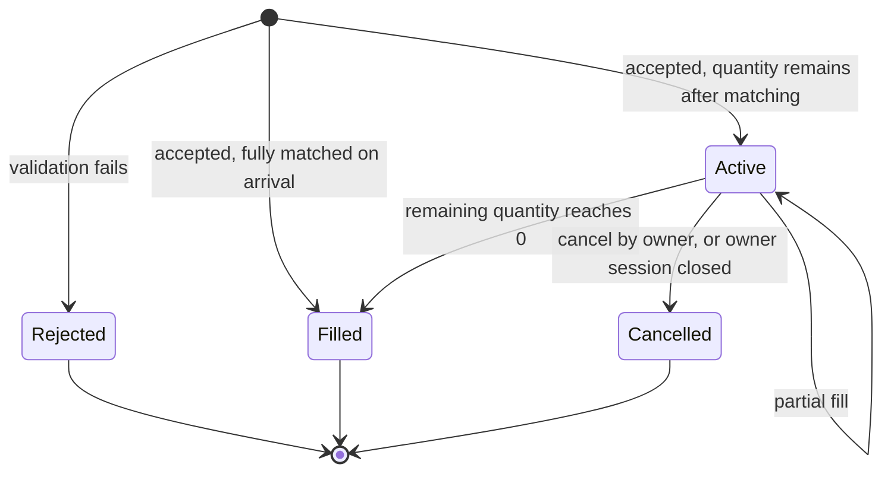

# Exchange — Technical Specification

**Status: in progress.** Sections 1–5 (the matching core) were approved on 2026-11-15.
The remaining sections are outlined only; each is written before the implementation step that depends on it.

This document defines behavior and contracts. It does not describe C++ class layouts; those are implementation details constrained by the contracts below.

## 1. Purpose and scope

Exchange is an educational, single-instrument electronic exchange simulator written in C++20.
It consists of a matching engine library and three terminal programs built on it: `exchange-server`, `exchange-cli`, and `exchange-bench`.

### 1.1 Goals

- A limit order book with price-time priority whose behavior is fully specified and tested.
- Deterministic matching: the same command sequence always produces the same events.
- A TCP server that separates networking from matching using bounded queues.
- Reproducible, honestly reported latency and throughput measurements.

### 1.2 Non-goals

Multiple instruments, market or stop orders, order modification, accounts and authentication, persistence, risk checks, and any form of real trading.
An order that needs a different price or quantity is cancelled and resubmitted.

### 1.3 Glossary

| Term | Meaning |
|---|---|
| Resting order | An order waiting in the book. |
| Incoming order | The order currently being processed by the engine. |
| Maker / taker | In a trade, the resting order is the maker and the incoming order is the taker. |
| Level | All resting orders on one side at one price. |
| Best bid / best ask | The highest resting buy price / the lowest resting sell price. |
| Session | One client connection, identified by a `SessionId`. |
| Active order | An accepted order with remaining quantity greater than zero. |

## 2. Data model

All prices and quantities are integers. The engine never uses floating point.

| Type | Valid range | Assigned by | Notes |
|---|---|---|---|
| `Side` | `Buy`, `Sell` | client | |
| `Price` | 1 to 1,000,000,000 ticks | client | A tick is the smallest price increment. |
| `Quantity` | 1 to 1,000,000,000 units | client | |
| `ClientOrderId` | 1 to 2^64 − 1 | client | Strictly increasing per session (section 4.1). |
| `OrderId` | 1 to 2^64 − 1 | engine | Starts at 1, incremented by 1 for each accepted order. Never reused. |
| `SessionId` | 1 to 2^64 − 1 | gateway | Never reused during a server run. Opaque to the engine. |

This specification fixes value ranges. In-memory integer widths are an implementation detail as long as every valid value is representable. Wire widths are fixed in section 7.

**Overflow.** The engine never multiplies a price by a quantity. The only accumulated value is the total quantity of a level, held in a 64-bit unsigned integer. With quantities capped at 10^9, overflowing it would require more than 10^10 resting orders at one price, which cannot fit in memory.

**Time.** The engine has no clock. "Older" means "accepted earlier", so within the book a smaller `OrderId` always means higher time priority.

## 3. Order lifecycle

- A rejected order never receives an `OrderId` and never touches the book.
- `Filled` and `Cancelled` are terminal. The engine keeps no record of terminal orders.
- For every accepted order: original quantity = filled quantity + cancelled quantity + remaining quantity.

## 4. Matching semantics

### 4.1 New order

Validation runs in this order. The first failing check determines the reject reason.

| # | Check | Reject reason |
|---|---|---|
| 1 | `client_order_id` is strictly greater than the last `client_order_id` consumed by this session (initially 0) | `InvalidClientOrderId` |
| 2 | `price` is within the valid range | `InvalidPrice` |
| 3 | `quantity` is within the valid range | `InvalidQuantity` |

A `client_order_id` is consumed as soon as it passes check 1, even if the order is then rejected by check 2 or 3. This guarantees that a `client_order_id` identifies at most one accept or reject per session.

An order that passes validation is accepted, receives the next `OrderId`, and is matched:

- **M1 (crossing).** An incoming buy at limit `P` can trade with the best ask while that ask's price is at most `P`. An incoming sell at limit `P` can trade with the best bid while that bid's price is at least `P`.
- **M2 (price priority).** The incoming order always trades with the best opposite level first.
- **M3 (time priority).** Within a level, resting orders trade in the order they were accepted.
- **M4 (trade price).** A trade executes at the resting order's price.
- **M5 (trade quantity).** A trade's quantity is the smaller of the two remaining quantities.
- **M6 (repeat).** Matching continues until the incoming order is filled or M1 no longer holds.
- **M7 (rest).** Any remaining quantity rests at the back of the level for its side and price.
- **M8 (self-trade).** Two orders from the same session can trade with each other. No self-trade prevention is applied.

### 4.2 Cancel

A cancel names an `OrderId`. It succeeds only if that order is active and was submitted by the cancelling session. The order's whole remaining quantity is removed.

Every other case — an identifier never assigned, an order already filled or cancelled, an order owned by another session — is rejected with the single reason `UnknownOrder`. Distinguishing these cases would require remembering every past order, and would reveal other sessions' orders.

### 4.3 Session closed

When a session closes, the engine cancels all of its active orders in increasing `OrderId` order, then discards the session's state.

### 4.4 Edge cases

| Case | Result |
|---|---|
| Repeated or lower `client_order_id` | `OrderRejected(InvalidClientOrderId)` |
| Price 0 or above the maximum | `OrderRejected(InvalidPrice)` |
| Quantity 0 or above the maximum | `OrderRejected(InvalidQuantity)` |
| Cancel after a full fill | `CancelRejected(UnknownOrder)` |
| Cancel after a partial fill | Succeeds; cancelled quantity is the remaining quantity |
| Cancel repeated twice | Second cancel is `CancelRejected(UnknownOrder)` |
| Cancel of another session's order | `CancelRejected(UnknownOrder)` |
| Incoming order larger than all crossing liquidity | Trades with all of it, remainder rests |
| Session closes with no active orders | No events |

## 5. Engine interface

The engine is a single-threaded library with no I/O, no clock, and no knowledge of networking. It consumes one command at a time and emits an ordered list of events for it.

### 5.1 Commands

| Command | Fields |
|---|---|
| `NewOrder` | `session_id`, `client_order_id`, `side`, `price`, `quantity` |
| `CancelOrder` | `session_id`, `order_id` |
| `SessionClosed` | `session_id` |
| `SnapshotRequest` | `session_id` |

A session needs no explicit opening: its state is created by its first `NewOrder`.
`SnapshotRequest` reads the book without changing it; its purpose is explained in section 6.4.

### 5.2 Events

Private events concern one session. Public events describe the market and identify no session or order.

| Event | Visibility | Fields |
|---|---|---|
| `OrderAccepted` | private | `session_id`, `client_order_id`, `order_id` |
| `OrderRejected` | private | `session_id`, `client_order_id`, `reason` |
| `Fill` | private | `session_id`, `order_id`, `price`, `quantity`, `remaining_quantity` |
| `OrderCancelled` | private | `session_id`, `order_id`, `cancelled_quantity`, `reason` (`Requested` or `SessionClosed`) |
| `CancelRejected` | private | `session_id`, `order_id`, `reason` |
| `SnapshotBegin` | private | `session_id` |
| `SnapshotLevel` | private | `session_id`, `side`, `price`, `total_quantity` |
| `SnapshotEnd` | private | `session_id` |
| `Trade` | public | `price`, `quantity`, `aggressor_side` |
| `BookUpdate` | public | `side`, `price`, `total_quantity` (new total of the level; 0 means the level no longer exists) |

### 5.3 Event order

The order of events is part of the contract.

**Rejected `NewOrder`:** exactly one `OrderRejected`.

**Accepted `NewOrder`:**

1. `OrderAccepted` for the incoming order.
2. For each opposite level traded with, from best price outward:
   1. For each trade at that level, in time priority: `Fill` for the maker, `Fill` for the taker, `Trade`.
   2. One `BookUpdate` for that level, after its last trade.
3. If quantity remains: one `BookUpdate` for the level the incoming order rests on.

**`CancelOrder`:** either `OrderCancelled` then `BookUpdate` for the order's level, or exactly one `CancelRejected`.

**`SnapshotRequest`:** `SnapshotBegin`, then one `SnapshotLevel` per bid level from the best price down, then one `SnapshotLevel` per ask level from the best price up, then `SnapshotEnd`. An empty book gives `SnapshotBegin` followed by `SnapshotEnd`.

**`SessionClosed`:** for each cancelled order, `OrderCancelled` then `BookUpdate` for its level. These `OrderCancelled` events are emitted even though the session can no longer receive them, so that every accepted order's history ends with a terminal event.

### 5.4 Worked examples

**Example A — price priority, time priority, partial fill.** Sessions are named A, B, C for readability.

Resting asks before the command:

| OrderId | Session | Price | Remaining |
|---|---|---|---|
| 1 | A | 101 | 5 |
| 2 | B | 101 | 3 |
| 3 | A | 102 | 10 |

Command: `NewOrder(session C, client_order_id 1, Buy, price 102, quantity 12)`

| # | Event |
|---|---|
| 1 | `OrderAccepted(C, client_order_id 1, order 4)` |
| 2 | `Fill(A, order 1, price 101, quantity 5, remaining 0)` |
| 3 | `Fill(C, order 4, price 101, quantity 5, remaining 7)` |
| 4 | `Trade(101, 5, Buy)` |
| 5 | `Fill(B, order 2, price 101, quantity 3, remaining 0)` |
| 6 | `Fill(C, order 4, price 101, quantity 3, remaining 4)` |
| 7 | `Trade(101, 3, Buy)` |
| 8 | `BookUpdate(Sell, 101, 0)` |
| 9 | `Fill(A, order 3, price 102, quantity 4, remaining 6)` |
| 10 | `Fill(C, order 4, price 102, quantity 4, remaining 0)` |
| 11 | `Trade(102, 4, Buy)` |
| 12 | `BookUpdate(Sell, 102, 6)` |

The buyer was willing to pay 102 but pays 101 for the first 8 units (M4). Order 1 trades before order 2 because it was accepted first (M3).

**Example B — remainder rests, then cancel.** The book holds one ask: order 1, price 101, remaining 5.

| Command | Events |
|---|---|
| `NewOrder(C, 1, Buy, 101, 8)` | `OrderAccepted(C, 1, order 2)`, `Fill(order 1, 101, 5, remaining 0)`, `Fill(order 2, 101, 5, remaining 3)`, `Trade(101, 5, Buy)`, `BookUpdate(Sell, 101, 0)`, `BookUpdate(Buy, 101, 3)` |
| `CancelOrder(C, order 2)` | `OrderCancelled(C, order 2, cancelled 3, Requested)`, `BookUpdate(Buy, 101, 0)` |
| `CancelOrder(C, order 2)` | `CancelRejected(C, order 2, UnknownOrder)` |

### 5.5 Determinism

The emitted events are a function of the engine configuration and the command sequence only. The engine must not depend on wall-clock time, random numbers, memory addresses, thread scheduling, or the iteration order of unordered containers.

### 5.6 Invariants

These hold after every command. A test-only checker verifies them.

- **I1.** If both sides are non-empty, best bid < best ask.
- **I2.** Every active order has 0 < remaining quantity ≤ original quantity.
- **I3.** Every level's total equals the sum of its orders' remaining quantities, and no level is empty.
- **I4.** Within a level, `OrderId`s are strictly increasing from front to back.
- **I5.** The cancel index contains exactly the active orders.
- **I6.** Each session's order set contains exactly that session's active orders.
- **I7.** Every `Trade` is preceded by exactly two `Fill` events with the same price and quantity.

## 6. Event delivery and market data

### 6.1 One ordered stream

The engine processes one command at a time, and the events of a command are ordered by section 5.3. All events therefore form a single sequence. Whatever carries events from the engine to clients must preserve that order: a client receives the events addressed to it in the order the engine emitted them.

### 6.2 Routing

- A private event is delivered to the session it names. If that session no longer exists, the event is discarded.
- A public event (`Trade`, `BookUpdate`) is delivered to every session that is subscribed to market data at that point of the stream.

A session that takes part in a trade and is subscribed receives both its private `Fill` and the public `Trade`.

### 6.3 Market data sequence numbers

The publisher numbers public events 1, 2, 3, … in stream order, for the whole life of the server. The number is carried on the wire with each `Trade` and `BookUpdate`. It is not part of the engine's events: the engine's output stays independent of who is listening.

A subscribed client must receive consecutive numbers. Delivery is reliable (decision D2), so a gap can only mean a defect; a client that sees one discards its copy of the book and subscribes again.

### 6.4 Subscription and snapshot

A client that wants market data sends a subscribe request. It needs two things: the current content of the book, and every change after that, with nothing missing and nothing applied twice in between.

The subscribe request becomes a `SnapshotRequest` command, which travels through the same path as orders. The engine answers it with the snapshot events of section 5.3, placed in the event stream exactly where the snapshot was taken. The publisher then:

1. sends the snapshot to the session, stating the sequence number of the last public event that preceded it;
2. marks the session as subscribed when it reaches `SnapshotEnd`.

Every public event after `SnapshotEnd` in the stream is newer than the snapshot, and every one before it is already included. No lock on the book is needed, because the snapshot is taken by the thread that owns the book.

The snapshot contains every level of both sides. Its cost is proportional to the number of levels and is paid on the matching thread; this is accepted because subscriptions are rare compared with orders.

Subscribing again is allowed: the session receives a new snapshot and stays subscribed. There is no unsubscribe; a client stops market data by disconnecting.

### 6.5 Maintaining a book from market data

A client builds the book from the snapshot levels, then applies each `BookUpdate` by replacing the total of that side and price; a total of 0 removes the level. `Trade` events do not change the client's book: the `BookUpdate` that follows already reflects them.

## 7. Wire protocol

### 7.1 Transport and framing

Clients and server exchange binary messages over TCP. One connection is one session.

TCP delivers a stream of bytes with no message boundaries: one read can return half a message or several messages at once. Every message therefore starts with a header that says how long it is.

| Offset | Size | Field | Meaning |
|---|---|---|---|
| 0 | 2 | `length` | Number of bytes in the body, after this header |
| 2 | 1 | `type` | Message type |
| 3 | `length` | body | Fields of the message, in the order of the tables below |

Rules that apply to every message:

- Integers are little-endian. `u8`, `u16`, `u32`, `u64` are unsigned; `i64` is signed, two's complement.
- There is no padding between fields.
- Each message type has one fixed body length. A header whose `length` differs from it, or exceeds 64, is a protocol error.
- Messages are encoded and decoded field by field. The in-memory layout of a C++ struct is never sent, because it depends on the compiler and the processor.

### 7.2 Messages from client to server

| Type | Name | Body | Body length |
|---|---|---|---|
| `0x01` | `Hello` | `magic: u32`, `version: u16` | 6 |
| `0x02` | `NewOrder` | `client_order_id: u64`, `side: u8`, `price: i64`, `quantity: u64` | 25 |
| `0x03` | `CancelOrder` | `order_id: u64` | 8 |
| `0x04` | `Subscribe` | empty | 0 |

### 7.3 Messages from server to client

| Type | Name | Body | Body length |
|---|---|---|---|
| `0x81` | `HelloAck` | `version: u16`, `session_id: u64` | 10 |
| `0x82` | `OrderAccepted` | `client_order_id: u64`, `order_id: u64` | 16 |
| `0x83` | `OrderRejected` | `client_order_id: u64`, `reason: u8` | 9 |
| `0x84` | `Fill` | `order_id: u64`, `price: i64`, `quantity: u64`, `remaining_quantity: u64` | 32 |
| `0x85` | `OrderCancelled` | `order_id: u64`, `cancelled_quantity: u64`, `reason: u8` | 17 |
| `0x86` | `CancelRejected` | `order_id: u64`, `reason: u8` | 9 |
| `0x87` | `Trade` | `sequence: u64`, `price: i64`, `quantity: u64`, `aggressor_side: u8` | 25 |
| `0x88` | `BookUpdate` | `sequence: u64`, `side: u8`, `price: i64`, `total_quantity: u64` | 25 |
| `0x89` | `SnapshotBegin` | `last_sequence: u64` | 8 |
| `0x8A` | `SnapshotLevel` | `side: u8`, `price: i64`, `total_quantity: u64` | 17 |
| `0x8B` | `SnapshotEnd` | empty | 0 |
| `0x8F` | `ProtocolError` | `code: u8` | 1 |

Messages carry no session identifier: the connection identifies the session.

### 7.4 Field values

| Field | Values |
|---|---|
| `magic` | `0x48435845`, which is the ASCII text `EXCH` on the wire |
| `version` | `1` |
| `side`, `aggressor_side` | `0` buy, `1` sell |
| `reason` of `OrderRejected` | `1` invalid client order id, `2` invalid price, `3` invalid quantity |
| `reason` of `CancelRejected` | `1` unknown order |
| `reason` of `OrderCancelled` | `1` requested, `2` session closed |
| `code` of `ProtocolError` | `1` bad length, `2` unknown type, `3` bad field, `4` hello required, `5` bad magic, `6` unsupported version |

Any other value of an enumerated field is a protocol error (`bad field`).

`price` and `quantity` are not range-checked by the protocol layer. An order with an out-of-range price is well-formed; the engine rejects it with `OrderRejected` (section 4.1).

### 7.5 Conversation

1. The client connects and sends `Hello`.
2. The server answers `HelloAck` with the protocol version and the session's identifier.
3. The client sends `NewOrder`, `CancelOrder` and `Subscribe` in any order and at any time. The server sends the messages of section 7.3 as events occur.
4. Either side closes the connection to end the session.

Requests are not answered one by one: the server's messages form a stream, and a client matches them to its requests with `client_order_id` and `order_id`.

**Knowing that everything has been answered.** A request can produce several messages (an accepted order followed by fills), and nothing marks the last one. A client that needs to know that the server has finished with everything it sent can send a `CancelOrder` for `order_id` 0. That identifier is never assigned (section 2), so the request has no effect and is always answered by `CancelRejected` with `order_id` 0. Because that request passes through the engine after the earlier ones, its answer arrives after all of theirs. The command-line client does this after every command.

### 7.6 Protocol errors

A protocol error means the two sides no longer agree on where messages begin, or one side does not speak the protocol. It cannot be recovered from within the stream.

| Code | Condition |
|---|---|
| bad length | `length` exceeds 64 or does not match the message type |
| unknown type | `type` is not a message this side accepts |
| bad field | An enumerated field holds an undefined value |
| hello required | The first message is not `Hello`, or `Hello` is sent twice |
| bad magic | `Hello.magic` is wrong |
| unsupported version | `Hello.version` is not supported |

On a protocol error the server sends `ProtocolError` if it can, then closes the connection. Closing the connection closes the session, with the effect described in section 4.3.

A business rejection is different: `OrderRejected` and `CancelRejected` are normal messages, and the session continues.

## 8. Sessions

A session is one client connection, from the moment the server accepts it until it is closed.

### 8.1 Lifecycle

1. The server accepts the connection and assigns the next `SessionId`. Identifiers start at 1 and are never reused while the server runs.
2. The client sends `Hello`; the server answers `HelloAck`. Until then, any other message is a protocol error.
3. The session is active: the client sends orders, cancels and subscriptions.
4. The session closes.

The server identifies a connection by its `SessionId`, never by its file descriptor: the operating system reuses a descriptor number as soon as a socket is closed, so an event still in transit for an old connection could otherwise reach a new one.

### 8.2 Closing

A session closes when:

- the client closes the connection, or the network reports an error;
- the client causes a protocol error (section 7.6);
- the client does not read fast enough (section 10.1).

When a session that completed the handshake closes, the server discards its unsent output, removes it from market data subscribers, and submits `SessionClosed` to the engine, which cancels its orders (section 4.3). A connection that never completed the handshake has no state in the engine, so nothing is submitted.

A client that reconnects gets a new session. It cannot reach the orders of its previous session, which were cancelled.

## 9. Threading model

### 9.1 Bounded SPSC queue

Threads exchange messages through `SpscQueue<T>`, a bounded ring buffer for exactly one producer thread and one consumer thread.

**Contract.**

- `try_push` may be called by one thread only, the producer. `try_pop` may be called by one thread only, the consumer. Any other use is a data race.
- The capacity is fixed at construction and rounded up to a power of two.
- `try_push` on a full queue returns `false` and changes nothing. `try_pop` on an empty queue returns `false` and changes nothing. What a thread does next (retry, wait, apply backpressure) is decided by the caller, as specified in section 10.
- Elements are delivered exactly once, in the order they were pushed.
- Neither operation blocks, allocates, or makes a system call.
- `T` must be trivially copyable, so that a slot can be overwritten without running constructors or destructors.

**Synchronization.** The queue keeps two positions that only ever increase: `tail`, written only by the producer, and `head`, written only by the consumer. There is no lock.

| Access | Memory order | Reason |
|---|---|---|
| A thread loads its own position | `relaxed` | No other thread writes it. |
| The producer stores `tail` after writing a slot | `release` | Publishes the slot's content together with the new position. |
| The consumer loads `tail` | `acquire` | Guarantees that every slot before `tail` is completely written. |
| The consumer stores `head` after reading a slot | `release` | Publishes that the slot has been read. |
| The producer loads `head` | `acquire` | Guarantees that the consumer has finished reading a slot before it is overwritten. |

`head` and `tail` are each aligned to their own 64-byte cache line, so that the producer's writes do not invalidate the cache line the consumer is working with, and conversely.

**Validation.** Single-thread tests cover the boundaries (empty, full, wrap-around). Two-thread tests transfer a known sequence and check order and integrity, and run under ThreadSanitizer in CI. Weakening the `release`/`acquire` pair on `tail` to `relaxed` still passes the functional test on x86-64 but is reported by ThreadSanitizer as a data race: the functional test alone cannot validate the memory orderings.

### 9.2 Execution modes

The server is built in two modes (decision D5).

**Inline mode.** One thread does everything: it runs the event loop, decodes messages, calls the matching engine directly, and writes the answers. There is no queue and no shared state. This is the mode currently implemented.

**Pipeline mode.** A network thread and a matching thread connected by two SPSC queues. To be specified with its implementation.

### 9.3 Event loop

The network side is a single-threaded event loop on Linux `epoll`:

1. Ask the kernel which sockets are ready (`epoll_wait`). This is the only place where the thread sleeps.
2. For each ready socket: accept new connections, or read what has arrived and process every complete message, or continue a pending write.
3. Send the output produced during this iteration, then close the sessions that must be closed.

Rules:

- Every socket is non-blocking. A read returns what has already arrived; a write sends what the kernel accepts and the rest stays in the session's output buffer until the socket is writable again.
- `epoll` is used level-triggered: a socket is reported as long as it has data to read. One read is done per report, so that one busy client cannot keep the loop away from the others.
- Messages produced for a session during one iteration are sent with one write.
- Closing a session is deferred to the end of the iteration, because the code that detects the reason is often still working with that session.
- Nagle's algorithm is disabled on every connection (`TCP_NODELAY`).

### 9.4 Startup and shutdown

The server binds and listens when it is created; failing to do so is a fatal error (section 11). A stop request, from another thread or from a signal handler, writes to an `eventfd` that the event loop watches; the loop then returns and the server closes every connection. Orders resting in the book are lost with the process: there is no persistence (section 1.2).

## 10. Backpressure and delivery contract

Sections on the queues between threads are written with the pipeline mode.

### 10.1 Slow clients

Each session has an output buffer holding the bytes the kernel has not accepted yet. If it grows beyond a configured limit (1 MiB by default), the server closes the session.

This gives the delivery contract for private events: a client either receives every message addressed to it, in order, or its connection is closed. Messages are never dropped individually. A closed session's orders are cancelled (section 8.2), so a client that was cut off knows the state it left: no order of that session is still active.

The same rule applies to market data (decision D2): a subscriber that cannot keep up is disconnected, and gets a fresh snapshot when it connects and subscribes again.

## 11. Error handling

| Kind | Example | Effect |
|---|---|---|
| Business rejection | Invalid price; cancel of an unknown order | `OrderRejected` or `CancelRejected`. The session continues. |
| Protocol error | Unknown message type; first message is not `Hello` | `ProtocolError` if possible, then the session is closed (sections 7.6 and 8.2). |
| Connection failure | Reset by peer; client too slow | The session is closed (section 8.2). Other sessions are not affected. |
| Fatal error | Cannot bind the listening port; `epoll` fails | The server reports the error and exits with a non-zero status. |
| Broken invariant | A state the code assumes impossible | Assertion failure in debug builds. Never used for conditions a client can cause. |

No input from a client can make the server exit or affect another session, other than through the market itself.

## 12. Replay format

`exchange-replay` feeds a command script to a new engine and prints the resulting events. Because the engine is deterministic (section 5.5), the same script always produces the same output, byte for byte.

### 12.1 Input

Text, one command per line. Words are separated by spaces or tabs. Empty lines and lines whose first non-blank character is `#` are ignored.

| Line | Command |
|---|---|
| `new <session_id> <client_order_id> <buy\|sell> <price> <quantity>` | `NewOrder` |
| `cancel <session_id> <order_id>` | `CancelOrder` |
| `close <session_id>` | `SessionClosed` |
| `snapshot <session_id>` | `SnapshotRequest` |

Numbers are decimal integers. The price may be negative or out of range, so that a script can exercise validation; such an order is rejected by the engine, not by the parser.

A line that is not a well-formed command stops the replay. The tool reports its line number and exits with a non-zero status.

### 12.2 Output

For each command, the line `> ` followed by the command, then one line per event in the order of section 5.3.

| Event | Line |
|---|---|
| `OrderAccepted` | `accepted session=S client_order_id=C order_id=O` |
| `OrderRejected` | `rejected session=S client_order_id=C reason=R` |
| `Fill` | `fill session=S order_id=O price=P quantity=Q remaining=Q` |
| `OrderCancelled` | `cancelled session=S order_id=O quantity=Q reason=R` |
| `CancelRejected` | `cancel_rejected session=S order_id=O reason=R` |
| `Trade` | `trade price=P quantity=Q aggressor=buy\|sell` |
| `BookUpdate` | `book side=buy\|sell price=P total=Q` |
| `SnapshotBegin` | `snapshot_begin session=S` |
| `SnapshotLevel` | `snapshot_level session=S side=buy\|sell price=P total=Q` |
| `SnapshotEnd` | `snapshot_end session=S` |

Reasons are written in lower case with underscores: `invalid_client_order_id`, `invalid_price`, `invalid_quantity`, `unknown_order`, `requested`, `session_closed`.

## 13. Benchmark methodology

### 13.1 Rules

- A result always states its timing boundary: where the clock starts and where it stops. Results with different boundaries are never compared.
- A result always states its environment: processor, operating system, whether it ran under WSL2, compiler and version, compiler flags and build type.
- Only numbers that were measured are published. A build with a sanitizer or with assertions enabled is not a performance measurement, and the tool says so.
- The workload is generated from a seed and is identical on every platform, so a result can be reproduced.
- Nothing in the timed region logs, prints, or allocates for the benchmark's own bookkeeping.

### 13.2 Workload

A synthetic order flow around a fixed mid price.

| Kind | Description |
|---|---|
| Passive order | A buy priced 1 to `price_levels` ticks below the mid price, or a sell priced as far above it. It rests. |
| Aggressive order | A buy priced `price_levels` ticks above the mid price, or a sell priced as far below it. It trades with the best opposite levels. |
| Cancel | Cancels one live order chosen at random, sent by the session that owns it. |

Side, price distance, quantity (1 to `max_quantity`) and session are drawn uniformly. Before measurement, `initial_orders` passive orders fill the book. Each measured command is then an aggressive order with probability `aggressive_percent`, a cancel with probability `cancel_percent`, and a passive order otherwise. If the number of live orders falls below half of `initial_orders`, only passive orders are generated until it recovers; above twice `initial_orders`, cancels replace passive orders.

The generator runs the commands through an engine of its own, so every cancel targets an order that is live at that point. Every generated command is valid.

This workload is not a model of a real market. It exercises the three paths of the engine in controlled proportions.

### 13.3 Engine benchmark

**Boundary.** The time of one call to `MatchingEngine::process()`: the clock is read immediately before the call and immediately after it returns. It includes validation, matching, book updates and the construction of events in a pre-allocated buffer. It excludes parsing, networking, queues and thread hand-offs.

**Procedure.**

1. Generate the workload in memory.
2. For each run, create a new engine and apply the setup commands, untimed.
3. Latency pass: time each measured command individually and keep every sample.
4. Throughput pass: on another new engine, time the whole measured stream with two clock readings.
5. Execute `warmup_runs` unmeasured runs first, then `runs` measured runs.

Each run reports the minimum, the 50th, 95th, 99th and 99.9th percentiles, the maximum and the mean latency, and the throughput. Percentiles use the nearest-rank definition on the full set of samples. The summary line is the median of each statistic across runs.

Every pass replays the same commands, so it must produce the same number of events as the generator did; a run that does not is reported as an error.

### 13.4 Clock

A latency of a few hundred nanoseconds needs a clock with a much smaller step. `std::chrono::steady_clock` does not always provide one: under WSL2 it advances in steps of 100 ns.

By default the benchmark reads the processor's timestamp counter (TSC) and converts ticks to nanoseconds with a rate calibrated against `steady_clock` at startup. The TSC is used only if two successive calibrations agree within 0.1 %; otherwise the benchmark falls back to `steady_clock`. After each latency pass, the duration of the pass according to the TSC is compared with its duration according to `steady_clock`; a difference above 1 % is reported as an error.

Every report states which clock was used, the smallest interval it can measure, and the cost of one reading. Each latency sample includes about one reading cost; it is not subtracted.

### 13.5 Queue benchmark

**Boundary.** The time for a consumer thread to receive a fixed number of commands sent by a producer thread, from the start signal to the last message. The result is a throughput in messages per second. It is not a latency measurement.

**Procedure.** The same stream is transferred through `SpscQueue` and through a queue with the same ring buffer protected by one mutex, alternately, for `runs` runs. Both threads spin while the queue is full or empty. The consumer checks that the messages arrive in order.

The comparison answers one question: whether the lock-free queue transfers more messages than the simplest correct alternative when both threads are busy. It says nothing about behavior when a thread sleeps while waiting.

### 13.6 Known limits

- Measurements taken under WSL2 run in a virtual machine. They are labeled as such and are indicative, especially the high percentiles and the maximum.
- The benchmark does not pin its thread to a core, isolate cores, or control processor frequency scaling.
- The maximum latency mostly reflects interruptions by the operating system, not the engine.

## 14. Section to be written

| # | Section | Needed before |
|---|---|---|
| 14 | Testing strategy and acceptance criteria | First release |

## 15. Decision log

| # | Decision | Alternative considered | Reason |
|---|---|---|---|
| D1 | Two threads: one I/O thread owning every socket, one matching thread. The I/O thread also consumes the event queue. | A third thread that publishes events. | A publisher writing to sockets that another thread reads and closes makes connection state shared between threads. |
| D2 | Market data is reliable. A client that cannot keep up is disconnected and resynchronizes from a snapshot when it reconnects. | Lossy market data with gap detection and replay. | Over TCP the only source of loss is a slow client; disconnecting it needs no recovery protocol. |
| D3 | Clients supply a strictly increasing `client_order_id`; the engine assigns `OrderId`. Cancels name the `OrderId`. | Client-chosen order identifiers; arbitrary unique client identifiers. | Duplicate detection needs one integer per session instead of a history of all identifiers. |
| D4 | A session's active orders are cancelled when it closes. | Leave them resting. | Without accounts, nobody could ever cancel them. |
| D5 | The server is first built with the engine called directly from the I/O thread, then with a dedicated engine thread. Both modes remain available. | Build the threaded pipeline directly. | Separates networking bugs from concurrency bugs, and lets the benchmark compare the two designs. |
| D6 | GoogleTest is the only third-party dependency. Benchmarks use a harness written in this repository. | Catch2 or doctest; Google Benchmark; HdrHistogram. | GoogleTest is the framework most widely used in C++ industry codebases. The benchmark harness needs full latency distributions, which is a small amount of code. |
| D7 | One `BookUpdate` per level per command, emitted after the last trade at that level. | One `BookUpdate` per trade. | A large order sweeping one level produces one update instead of one per resting order. |
| D8 | A single cancel reject reason, `UnknownOrder`. | Separate reasons for filled, cancelled, and foreign orders. | Avoids unbounded history and does not reveal other sessions' orders. |
| D9 | The book uses standard containers: an ordered map of price levels per side, a linked list of orders per level, and a hash map from `OrderId` to the order's position. | A sorted array of levels; an array indexed by price; a custom memory pool. | It is the simplest structure with the right complexity for every operation. It is the baseline that later optimizations must beat in a benchmark. |
| D10 | `Price`, `Quantity` and the identifier types are plain integer aliases. Aggregates are built with designated initializers, which static analysis enforces. | A distinct wrapper type for each. | Wrapper types catch swapped arguments at compile time but need operator boilerplate. Naming every field at the construction site covers most of the same risk. |
| D11 | Latencies are timed with the processor's timestamp counter, calibrated against `steady_clock` and cross-checked after every pass. | `steady_clock` only. | Under WSL2 `steady_clock` advances in steps of 100 ns, which is too coarse for operations of about 500 ns. |
| D12 | Threads communicate through a lock-free SPSC ring buffer written for this project. | A queue protected by a mutex; an existing library. | Writing it is one of the project's goals. It is kept only because the benchmark shows a gain over the mutex version (docs/BENCHMARKS.md). |
| D13 | A market data subscription is served by a snapshot command that goes through the engine like an order. | Let the network thread read the book directly; maintain a copy of the book in the network thread. | The book has a single owner, so reading it from another thread would need a lock. Putting the snapshot in the event stream also fixes exactly which updates come before and after it. |
| D14 | Market data sequence numbers are assigned by the publisher and exist only on the wire. | Sequence fields inside the engine's `Trade` and `BookUpdate` events. | The engine's output stays a function of its commands alone, and replay files do not depend on a numbering that only matters to network clients. |
| D15 | The wire format is little-endian with a 3-byte header (`length`, `type`) and fixed-size bodies, encoded field by field. | Big-endian "network order"; sending C++ structs; a text protocol. | Every machine this runs on is little-endian. Field-by-field encoding makes the format independent of compiler padding and alignment. Fixed sizes make a malformed length detectable. |
| D16 | The network side is one thread using level-triggered `epoll` on non-blocking sockets. | One thread per connection; edge-triggered `epoll`; `io_uring`. | A thread per connection would need locks around everything shared. Edge-triggered mode reports readiness only once, so a missed read stalls a connection silently; level-triggered mode cannot lose a readiness report. |
| D17 | The command-line client shows prices in ticks and quantities in units, as whole numbers. | Decimal display with a configurable tick size. | A conversion would only exist in the client and add a place where rounding could go wrong; integers are what the protocol and the engine use. |
| D18 | The command-line client waits for the server's answers after each command, using the cancel of order 0 as a marker. | Print answers whenever they arrive; add a dedicated ping message to the protocol. | It makes scripted sessions produce the same transcript on every run. The marker must pass through the engine to be ordered after the engine's events, which an existing request already does. |

## 16. Open questions

- Should the engine cap the number of active orders and reject new ones beyond it? A bound keeps memory use predictable; the cost is one more reject reason.
