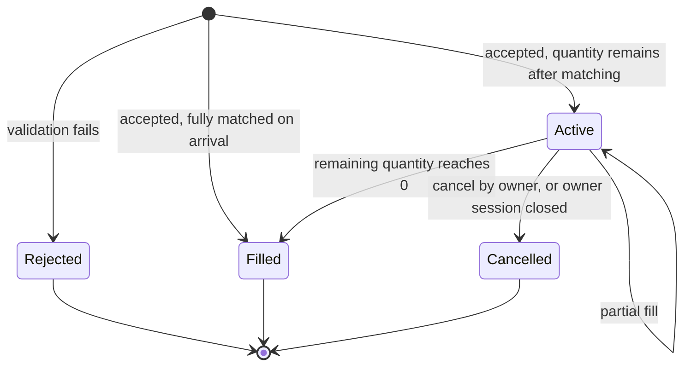

# Exchange — Technical Specification

**Status: in progress.** Sections 1–5 (the matching core) were approved on 2026-11-15.
Sections 6–14 are outlined only; each will be written and approved before the implementation step that depends on it.

This document defines behavior and contracts. It does not describe C++ class layouts; those are implementation details constrained by the contracts below.

## 1. Purpose and scope

Exchange is an educational, single-instrument electronic exchange simulator written in C++20.
It consists of a matching engine library and three terminal programs built on it: `exchange-server`, `exchange-cli`, and `exchange-bench`.

### 1.1 Goals

- A limit order book with price-time priority whose behavior is fully specified and tested.
- Deterministic matching: the same command sequence always produces the same events.
- A TCP server that separates networking from matching using bounded queues.
- Reproducible, honestly reported latency and throughput measurements.

### 1.2 Non-goals

Multiple instruments, market or stop orders, order modification, accounts and authentication, persistence, risk checks, and any form of real trading.
An order that needs a different price or quantity is cancelled and resubmitted.

### 1.3 Glossary

| Term | Meaning |
|---|---|
| Resting order | An order waiting in the book. |
| Incoming order | The order currently being processed by the engine. |
| Maker / taker | In a trade, the resting order is the maker and the incoming order is the taker. |
| Level | All resting orders on one side at one price. |
| Best bid / best ask | The highest resting buy price / the lowest resting sell price. |
| Session | One client connection, identified by a `SessionId`. |
| Active order | An accepted order with remaining quantity greater than zero. |

## 2. Data model

All prices and quantities are integers. The engine never uses floating point.

| Type | Valid range | Assigned by | Notes |
|---|---|---|---|
| `Side` | `Buy`, `Sell` | client | |
| `Price` | 1 to 1,000,000,000 ticks | client | A tick is the smallest price increment. |
| `Quantity` | 1 to 1,000,000,000 units | client | |
| `ClientOrderId` | 1 to 2^64 − 1 | client | Strictly increasing per session (section 4.1). |
| `OrderId` | 1 to 2^64 − 1 | engine | Starts at 1, incremented by 1 for each accepted order. Never reused. |
| `SessionId` | 1 to 2^64 − 1 | gateway | Never reused during a server run. Opaque to the engine. |

This specification fixes value ranges. In-memory integer widths are an implementation detail as long as every valid value is representable. Wire widths are fixed in section 7.

**Overflow.** The engine never multiplies a price by a quantity. The only accumulated value is the total quantity of a level, held in a 64-bit unsigned integer. With quantities capped at 10^9, overflowing it would require more than 10^10 resting orders at one price, which cannot fit in memory.

**Time.** The engine has no clock. "Older" means "accepted earlier", so within the book a smaller `OrderId` always means higher time priority.

## 3. Order lifecycle

- A rejected order never receives an `OrderId` and never touches the book.
- `Filled` and `Cancelled` are terminal. The engine keeps no record of terminal orders.
- For every accepted order: original quantity = filled quantity + cancelled quantity + remaining quantity.

## 4. Matching semantics

### 4.1 New order

Validation runs in this order. The first failing check determines the reject reason.

| # | Check | Reject reason |
|---|---|---|
| 1 | `client_order_id` is strictly greater than the last `client_order_id` consumed by this session (initially 0) | `InvalidClientOrderId` |
| 2 | `price` is within the valid range | `InvalidPrice` |
| 3 | `quantity` is within the valid range | `InvalidQuantity` |

A `client_order_id` is consumed as soon as it passes check 1, even if the order is then rejected by check 2 or 3. This guarantees that a `client_order_id` identifies at most one accept or reject per session.

An order that passes validation is accepted, receives the next `OrderId`, and is matched:

- **M1 (crossing).** An incoming buy at limit `P` can trade with the best ask while that ask's price is at most `P`. An incoming sell at limit `P` can trade with the best bid while that bid's price is at least `P`.
- **M2 (price priority).** The incoming order always trades with the best opposite level first.
- **M3 (time priority).** Within a level, resting orders trade in the order they were accepted.
- **M4 (trade price).** A trade executes at the resting order's price.
- **M5 (trade quantity).** A trade's quantity is the smaller of the two remaining quantities.
- **M6 (repeat).** Matching continues until the incoming order is filled or M1 no longer holds.
- **M7 (rest).** Any remaining quantity rests at the back of the level for its side and price.
- **M8 (self-trade).** Two orders from the same session can trade with each other. No self-trade prevention is applied.

### 4.2 Cancel

A cancel names an `OrderId`. It succeeds only if that order is active and was submitted by the cancelling session. The order's whole remaining quantity is removed.

Every other case — an identifier never assigned, an order already filled or cancelled, an order owned by another session — is rejected with the single reason `UnknownOrder`. Distinguishing these cases would require remembering every past order, and would reveal other sessions' orders.

### 4.3 Session closed

When a session closes, the engine cancels all of its active orders in increasing `OrderId` order, then discards the session's state.

### 4.4 Edge cases

| Case | Result |
|---|---|
| Repeated or lower `client_order_id` | `OrderRejected(InvalidClientOrderId)` |
| Price 0 or above the maximum | `OrderRejected(InvalidPrice)` |
| Quantity 0 or above the maximum | `OrderRejected(InvalidQuantity)` |
| Cancel after a full fill | `CancelRejected(UnknownOrder)` |
| Cancel after a partial fill | Succeeds; cancelled quantity is the remaining quantity |
| Cancel repeated twice | Second cancel is `CancelRejected(UnknownOrder)` |
| Cancel of another session's order | `CancelRejected(UnknownOrder)` |
| Incoming order larger than all crossing liquidity | Trades with all of it, remainder rests |
| Session closes with no active orders | No events |

## 5. Engine interface

The engine is a single-threaded library with no I/O, no clock, and no knowledge of networking. It consumes one command at a time and emits an ordered list of events for it.

### 5.1 Commands

| Command | Fields |
|---|---|
| `NewOrder` | `session_id`, `client_order_id`, `side`, `price`, `quantity` |
| `CancelOrder` | `session_id`, `order_id` |
| `SessionClosed` | `session_id` |

A session needs no explicit opening: its state is created by its first `NewOrder`.
A book snapshot command is specified with market data in section 6.

### 5.2 Events

Private events concern one session. Public events describe the market and identify no session or order.

| Event | Visibility | Fields |
|---|---|---|
| `OrderAccepted` | private | `session_id`, `client_order_id`, `order_id` |
| `OrderRejected` | private | `session_id`, `client_order_id`, `reason` |
| `Fill` | private | `session_id`, `order_id`, `price`, `quantity`, `remaining_quantity` |
| `OrderCancelled` | private | `session_id`, `order_id`, `cancelled_quantity`, `reason` (`Requested` or `SessionClosed`) |
| `CancelRejected` | private | `session_id`, `order_id`, `reason` |
| `Trade` | public | `price`, `quantity`, `aggressor_side` |
| `BookUpdate` | public | `side`, `price`, `total_quantity` (new total of the level; 0 means the level no longer exists) |

### 5.3 Event order

The order of events is part of the contract.

**Rejected `NewOrder`:** exactly one `OrderRejected`.

**Accepted `NewOrder`:**

1. `OrderAccepted` for the incoming order.
2. For each opposite level traded with, from best price outward:
   1. For each trade at that level, in time priority: `Fill` for the maker, `Fill` for the taker, `Trade`.
   2. One `BookUpdate` for that level, after its last trade.
3. If quantity remains: one `BookUpdate` for the level the incoming order rests on.

**`CancelOrder`:** either `OrderCancelled` then `BookUpdate` for the order's level, or exactly one `CancelRejected`.

**`SessionClosed`:** for each cancelled order, `OrderCancelled` then `BookUpdate` for its level. These `OrderCancelled` events are emitted even though the session can no longer receive them, so that every accepted order's history ends with a terminal event.

### 5.4 Worked examples

**Example A — price priority, time priority, partial fill.** Sessions are named A, B, C for readability.

Resting asks before the command:

| OrderId | Session | Price | Remaining |
|---|---|---|---|
| 1 | A | 101 | 5 |
| 2 | B | 101 | 3 |
| 3 | A | 102 | 10 |

Command: `NewOrder(session C, client_order_id 1, Buy, price 102, quantity 12)`

| # | Event |
|---|---|
| 1 | `OrderAccepted(C, client_order_id 1, order 4)` |
| 2 | `Fill(A, order 1, price 101, quantity 5, remaining 0)` |
| 3 | `Fill(C, order 4, price 101, quantity 5, remaining 7)` |
| 4 | `Trade(101, 5, Buy)` |
| 5 | `Fill(B, order 2, price 101, quantity 3, remaining 0)` |
| 6 | `Fill(C, order 4, price 101, quantity 3, remaining 4)` |
| 7 | `Trade(101, 3, Buy)` |
| 8 | `BookUpdate(Sell, 101, 0)` |
| 9 | `Fill(A, order 3, price 102, quantity 4, remaining 6)` |
| 10 | `Fill(C, order 4, price 102, quantity 4, remaining 0)` |
| 11 | `Trade(102, 4, Buy)` |
| 12 | `BookUpdate(Sell, 102, 6)` |

The buyer was willing to pay 102 but pays 101 for the first 8 units (M4). Order 1 trades before order 2 because it was accepted first (M3).

**Example B — remainder rests, then cancel.** The book holds one ask: order 1, price 101, remaining 5.

| Command | Events |
|---|---|
| `NewOrder(C, 1, Buy, 101, 8)` | `OrderAccepted(C, 1, order 2)`, `Fill(order 1, 101, 5, remaining 0)`, `Fill(order 2, 101, 5, remaining 3)`, `Trade(101, 5, Buy)`, `BookUpdate(Sell, 101, 0)`, `BookUpdate(Buy, 101, 3)` |
| `CancelOrder(C, order 2)` | `OrderCancelled(C, order 2, cancelled 3, Requested)`, `BookUpdate(Buy, 101, 0)` |
| `CancelOrder(C, order 2)` | `CancelRejected(C, order 2, UnknownOrder)` |

### 5.5 Determinism

The emitted events are a function of the engine configuration and the command sequence only. The engine must not depend on wall-clock time, random numbers, memory addresses, thread scheduling, or the iteration order of unordered containers.

### 5.6 Invariants

These hold after every command. A test-only checker verifies them.

- **I1.** If both sides are non-empty, best bid < best ask.
- **I2.** Every active order has 0 < remaining quantity ≤ original quantity.
- **I3.** Every level's total equals the sum of its orders' remaining quantities, and no level is empty.
- **I4.** Within a level, `OrderId`s are strictly increasing from front to back.
- **I5.** The cancel index contains exactly the active orders.
- **I6.** Each session's order set contains exactly that session's active orders.
- **I7.** Every `Trade` is preceded by exactly two `Fill` events with the same price and quantity.

## 6–14. Sections to be written

| # | Section | Needed before |
|---|---|---|
| 6 | Event sequencing, market data, book snapshot | Wire protocol |
| 7 | Wire protocol (framing, encoding, message tables, versioning, limits) | Codec |
| 8 | Sessions (connection lifecycle, ownership) | Server |
| 9 | Threading model (ownership, queues, wake-ups, startup, shutdown) | Engine thread |
| 10 | Backpressure and delivery contract | Engine thread |
| 11 | Error handling (business reject, protocol error, fatal error) | Server |
| 12 | Replay format | Replay tool |
| 13 | Benchmark methodology | Engine benchmark |
| 14 | Testing strategy and acceptance criteria | Build skeleton |

## 15. Decision log

| # | Decision | Alternative considered | Reason |
|---|---|---|---|
| D1 | Two threads: one I/O thread owning every socket, one matching thread. The I/O thread also consumes the event queue. | A third thread that publishes events. | A publisher writing to sockets that another thread reads and closes makes connection state shared between threads. |
| D2 | Market data is reliable. A client that cannot keep up is disconnected and resynchronizes from a snapshot when it reconnects. | Lossy market data with gap detection and replay. | Over TCP the only source of loss is a slow client; disconnecting it needs no recovery protocol. |
| D3 | Clients supply a strictly increasing `client_order_id`; the engine assigns `OrderId`. Cancels name the `OrderId`. | Client-chosen order identifiers; arbitrary unique client identifiers. | Duplicate detection needs one integer per session instead of a history of all identifiers. |
| D4 | A session's active orders are cancelled when it closes. | Leave them resting. | Without accounts, nobody could ever cancel them. |
| D5 | The server is first built with the engine called directly from the I/O thread, then with a dedicated engine thread. Both modes remain available. | Build the threaded pipeline directly. | Separates networking bugs from concurrency bugs, and lets the benchmark compare the two designs. |
| D6 | GoogleTest is the only third-party dependency. Benchmarks use a harness written in this repository. | Catch2 or doctest; Google Benchmark; HdrHistogram. | GoogleTest is the framework most widely used in C++ industry codebases. The benchmark harness needs full latency distributions, which is a small amount of code. |
| D7 | One `BookUpdate` per level per command, emitted after the last trade at that level. | One `BookUpdate` per trade. | A large order sweeping one level produces one update instead of one per resting order. |
| D8 | A single cancel reject reason, `UnknownOrder`. | Separate reasons for filled, cancelled, and foreign orders. | Avoids unbounded history and does not reveal other sessions' orders. |

## 16. Open questions

- Should the engine cap the number of active orders and reject new ones beyond it? A bound keeps memory use predictable; the cost is one more reject reason.
- How ticks and units are displayed by the CLI (for example 1 tick = 0.01 USD).
